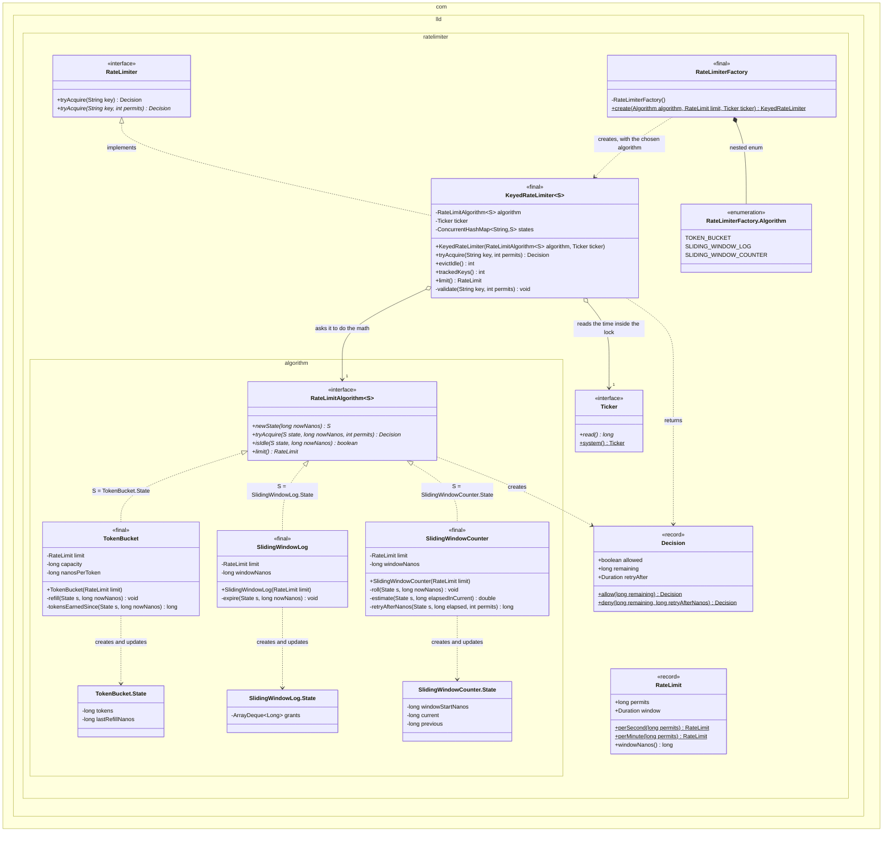
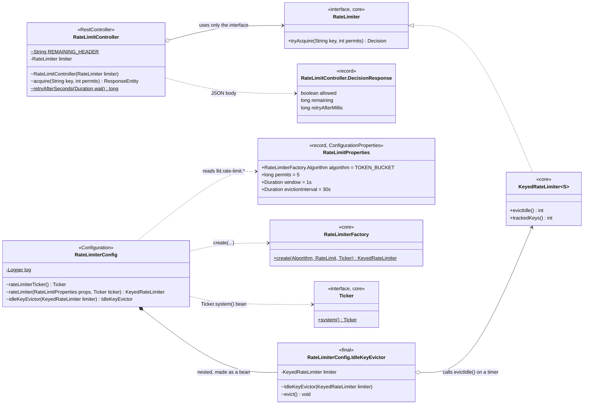
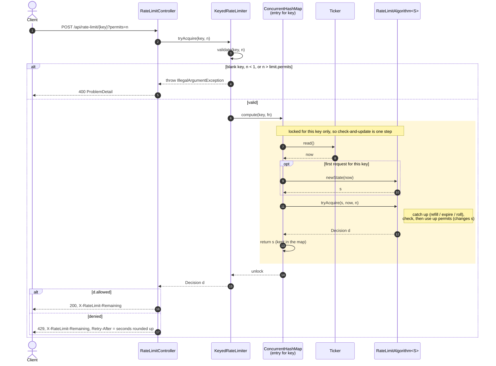
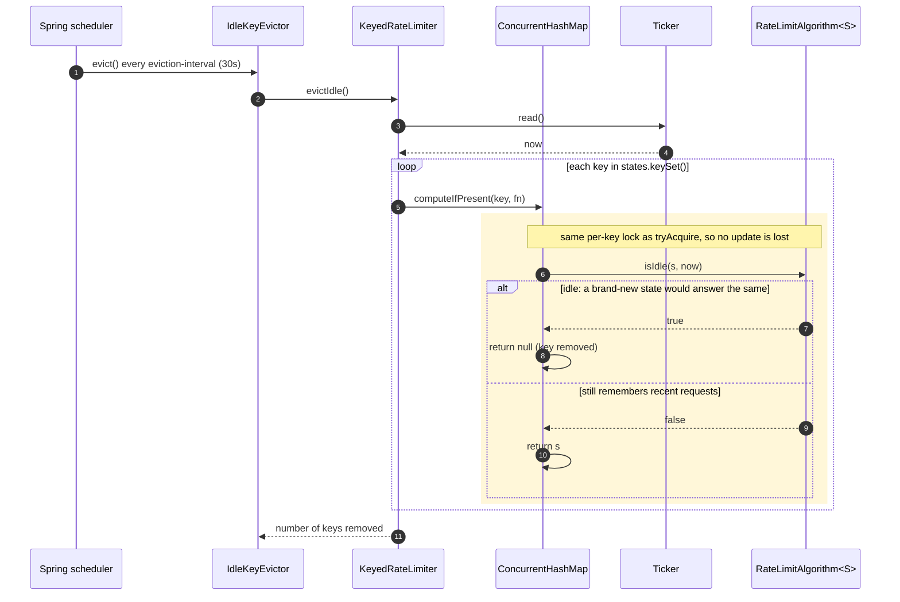

# Topic 21: Rate Limiter, UML

These are the formal UML pictures of the code in [`src/`](src/main/java/com/lld/ratelimiter/) and of the [`app/` HTTP adapter](../app/src/main/java/com/lld/app/ratelimiter/).

The [README](README.md#class-diagram-whiteboard-version) has the simple ASCII version you would draw on a whiteboard. These diagrams use Mermaid, so they stay plain text and render on GitHub and in most IDE Markdown previews.

| Diagram | The question it answers |
|---|---|
| [1. Core classes](#1-core-class-diagram) | Which class keeps the data, which classes do the math, and what gets passed in from outside? |
| [2. HTTP adapter classes](#2-http-adapter-class-diagram) | How does Spring plug the core in, without the core knowing about Spring? |
| [3. Sequence: one request](#3-sequence-one-request) | What happens, step by step, when one request comes in? Where is the lock? |
| [4. Sequence: idle-key eviction](#4-sequence-idle-key-eviction) | How is old data cleaned up without changing any answer? |

## How to read the symbols

| You see | It means |
|---|---|
| `+` before a name | public: anyone can use it |
| `-` before a name | private: only this class can use it |
| `~` before a name | package-private: only classes in the same package can use it |
| underlined name (`$` in the source) | static: belongs to the class, not to an object |
| *italic* method (`*` in the source) | abstract: no code here, a class that implements it must provide it |
| dotted line with a hollow triangle | "implements": the class at the plain end fills in that interface |
| solid line with a hollow diamond and arrow | "keeps a reference": the diamond side holds a field pointing at the arrow side |
| solid line with a filled diamond | "owns": the other type is nested inside, or is created and kept by this one |
| dotted arrow | "uses" or "creates": no field, just a call |

---

## 1. Core class diagram

**How to read this:** each box is one Java type. The top part of a box is its fields and the bottom part is its methods. The nested boxes are Java packages: `ratelimiter` is the main package `com.lld.ratelimiter`, and the `algorithm` box inside it is `com.lld.ratelimiter.algorithm`, where the three algorithms live. To keep the picture readable, two obvious links are not drawn: each algorithm keeps the `RateLimit` it was built with (see its `limit` field), and `RateLimiterFactory.create` builds the algorithm that matches the chosen `Algorithm` value.

**The one-sentence story:** `KeyedRateLimiter` keeps one small state object per user (key). For every request, it asks one `RateLimitAlgorithm` to do the math on that state.

What the picture tells you:

| Point | In plain words | Where to look |
|---|---|---|
| **Data lives in one place** | Each user's state object (`*.State`) is stored only in `KeyedRateLimiter.states`. The algorithm classes keep no per-user data, so one algorithm object is shared by every user. | The arrows to the `*.State` boxes say "creates and updates", not "keeps a reference" |
| **One lock per user** | `ConcurrentHashMap.compute` locks just that user's entry while the check and the update happen. Two requests for the same user can't both slip through (Topic 07). The algorithms never lock anything themselves. | `KeyedRateLimiter.states` |
| **Time is passed in** | `Ticker` has one method, `read()`. Real code uses `System::nanoTime`, and tests use a fake clock that they move by hand (Topic 10). | `Ticker` |
| **Swappable algorithms (Strategy)** | All three algorithms implement the same `RateLimitAlgorithm<S>` interface. `S` is the type of that algorithm's own state object, so the compiler checks you never mix them up. | The three "S = …" lines |
| **Values check themselves** | `RateLimit` and `Decision` are records. Their constructors throw if you pass bad values, such as 0 permits or an "allowed" decision with a wait time. | The `<<record>>` boxes |
| **Why the algorithm package matters** | The algorithms live in a separate package, so the things they use must be public: `Decision.allow/deny` and `RateLimit.windowNanos()`. | The `+` on those methods |

---

## 2. HTTP adapter class diagram

**How to read this:** the boxes marked `core` come from diagram 1, and only the methods used here are shown. Everything else is Spring code in the `app/` module. Arrows only point from Spring code toward core code, never back. That's how the core stays free of Spring.

| Point | Why |
|---|---|
| The controller only knows `RateLimiter`, not `KeyedRateLimiter` | It only needs `tryAcquire`. Cleaning up old keys is a different job, done by a different bean. |
| A bad request (`IllegalArgumentException`) becomes HTTP 400 **inside the controller** | A global "any `IllegalArgumentException` = 400" handler would also hide real bugs in Spring as 400s (see `CLAUDE.md`, `app/` rules). |
| `Ticker` is a Spring bean | Tests can swap in a frozen clock. The core never calls `System.nanoTime` itself. |
| The algorithm and limit come from `application.yml` | `RateLimitProperties` reads `lld.rate-limit.*`, and the config hands those values to `RateLimiterFactory.create`. You can change the algorithm without changing code. |

---

## 3. Sequence: one request

**How to read this:** time flows from top to bottom. Each column is one object. A solid arrow is a method call, and a dashed arrow is the value coming back. The yellow box is the part that runs while the lock for this one user is held. `alt` means "one of these branches happens", and `opt` means "this only happens sometimes".

Two things to say out loud while drawing it:

1. **The time is read inside the lock (step 7).** Suppose it were read before `compute`. Thread A reads t=100, thread B reads t=105, and then B gets the lock first. When A runs next, its "now" is older than the last update, so time goes backwards for this key and `elapsed` becomes negative (README, *Concurrency model*).
2. **Checking the input happens outside the lock (step 3).** Asking for more permits than the limit (`n > limit`) could never succeed. It throws (and becomes 400) instead of answering 429, because a "try again later" would make the client retry forever.

---

## 4. Sequence: idle-key eviction

**How to read this:** a timer wakes up every 30 seconds and walks over every key. For each key it takes the same per-key lock a request would take, and asks the algorithm, "is this state the same as a brand-new one?" If yes, the key is removed to save memory.

`isIdle` means "throwing this state away can't change any future answer". For example, a token bucket that has refilled to full is exactly the same as a new bucket, so it is safe to delete. A new one will be made the next time that user sends a request.

The loop goes over `keySet()` while other threads keep using the map. Java's `ConcurrentHashMap` allows this: the loop may or may not see keys added during the walk, which is fine here.

The README's [eviction section](README.md#eviction-bounded-memory-without-changing-any-decision) describes the test that proves eviction is safe. The test runs the same requests with and without eviction after every call, and the answers are identical.

[← README](README.md) · [Index](../README.md)
